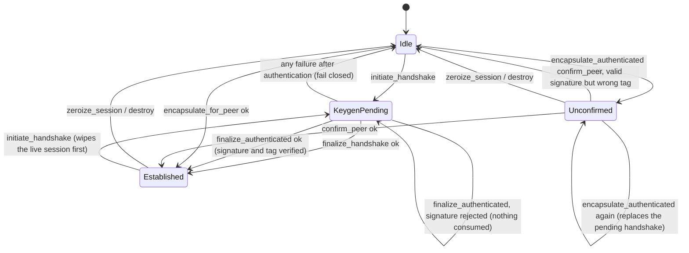

# Formal Analysis and Findings

Revision analysed: the commit that contains this file. Date: 2026-10-22.

## 1. Status and scope

**This is not a formal verification of ShawnCore, and nothing here is a proof of security.** It is
a structured analysis with three machine-checked parts, each bounded and each limited as stated:

| Part | Artifact | What it establishes | What it does not |
| --- | --- | --- | --- |
| Bounded symbolic model of the authenticated handshake | [`validation/formal/handshake_model.py`](validation/formal/handshake_model.py) | Within a fixed finite scenario and with ideal cryptography, the message design has no attack of the listed kinds, and a checker that must find attacks does find them in three weakened variants | Unbounded sessions, real cryptographic strength, the implementation |
| Exhaustive attacker-choice conformance test on the real code | [`shawncore-pq-crypto/tests/attacker_enumeration.rs`](shawncore-pq-crypto/tests/attacker_enumeration.rs) | For 576 combinations of attacker-controlled fields on the key-generating side and 24 on the confirming side, the real implementation gives exactly the outcome an executable specification predicts | Combinations outside the finite set; timing; memory safety |
| Mechanical interface checks | `validation/check_header_signatures.py`, `validation/check_docs.py`, C `_Static_assert`s, `validation/run_mutants.py` | Header and Rust signatures agree; documents reference things that exist; 23 injected faults are detected | Anything about behavior the tests do not exercise |

ProVerif and Tamarin were **not** used: neither was installed, neither is packaged for this
container's distribution, and downloading unverified binaries into a security evaluation was not
acceptable. The model is a small hand-written checker (about 300 lines)
and has not been reviewed by anyone else. A reviewer with ProVerif or Tamarin should re-express the
same message flow (section 3) in one of them; that remains open work (section 8).

Everything about the unauthenticated handshake, the entropy design, the RTOS primitives and
side channels is out of scope for the protocol parts and is covered, if at all, by the tests and
reviews recorded in [VALIDATION.md](VALIDATION.md).

## 2. Assumptions

Every claim in section 4 holds only under these. None is proved here.

| # | Assumption | Used for |
| --- | --- | --- |
| A1 | ML-KEM-1024 is IND-CCA2 secure (FIPS 203; implicit rejection on a bad ciphertext) | Key secrecy |
| A2 | X25519 hides the shared secret from anyone lacking either private key; the implementation rejects non-contributory results | Key secrecy |
| A3 | ML-DSA-87 is existentially unforgeable under chosen-message attack; signing is deterministic in this implementation | Authentication |
| A4 | HMAC-SHA384 is a PRF / MAC; HKDF-SHA384 behaves as a PRF; SHA-384 is collision resistant | Key confirmation, key separation, binding |
| A5 | ChaCha20 is a PRF; the Encrypt-then-MAC composition is as secure as its parts | Packet protection (not analysed here) |
| A6 | The host supplies unpredictable entropy and never reuses it | Freshness, key uniqueness |
| A7 | Trust anchors (the peer's ML-DSA verifying key) are provisioned out of band and are correct | Identity |
| A8 | Host callbacks and memory contracts hold ([SECURITY.md](SECURITY.md), "Host Integration Requirements") | Everything |

## 3. The protocol analysed

Roles: **K** generates ephemeral keys, **E** encapsulates. Each holds its own ML-DSA-87 signing key
and the other's verifying key. Full encodings are in [ARCHITECTURE.md](ARCHITECTURE.md) section 4.5.

```text
K -> E : ek, xK                                            (not authenticated)
E -> K : ct, xE, sigma_E, tag_E
         binding = H(version, suite, ek, xK, fp(vkK), fp(vkE), app_info)
         TH      = H(binding, ct, xE)
         PRK     = HMAC(salt, ss_KEM || dh)     kcE || kcK = Expand(PRK, label || 0 || inner)
         tag_E   = HMAC(kcE, label || TH)       sigma_E = Sign(skE, ctxE, H(TH, tag_E))
K -> E : sigma_K, tag_K
         tag_K   = HMAC(kcK, label || H(TH, tag_E))
         sigma_K = Sign(skK, ctxK, H(H(TH, tag_E), tag_K))
```

The salt is deliberately outside every hash that is transmitted or signed; it enters only through
the PRK. The session keys are `Expand(PRK, inner, 128)`, `inner = H(label, ct, xE, binding)`, and
the unauthenticated handshake uses the same derivation, so the two paths share one KDF.

## 4. Claims, arguments and evidence

For each claim: the argument is a sketch under the assumptions above, not a proof; "model" refers to
the scenarios in section 5; "conformance" to `attacker_enumeration.rs`.

| # | Claim | Argument | Evidence |
| --- | --- | --- | --- |
| C1 | K accepts only a message that E (the holder of `skE`) produced for this very exchange | `sigma_E` is checked first against the pinned `vkE` over a digest that contains K's own `ek`, `xK`, both identity fingerprints, `ct`, `xE` and `tag_E`; by A3 and A4 only E can produce it, and K's fresh `ek`/`xK` make it specific to this run | Model: agreement holds in all scenarios. Conformance: all 576 combinations; any altered field is `VerificationFailed` |
| C2 | E accepts a proof only from K for the same exchange | Symmetric: `sigma_K` covers the digest that contains `tag_E`, hence E's own ephemeral values | Model: agreement. Conformance: 24 combinations, wrong anchor, signature or tag all rejected |
| C3 | Acceptance implies both sides derived the same keys (key confirmation) | `tag_E` verifies only under `kcE`, which is derived from the PRK and `inner`; by A4 equality of tags implies equality of the PRK inputs (`salt`, `ss`, `dh`) and of `inner` | Model: "key agreement" holds; the v1 control (no tags) loses it under a salt mismatch. Conformance: a salt mismatch on an authentic exchange is always `KeyConfirmationFailed` and installs nothing |
| C4 | The session key stays secret if either the KEM secret or the X25519 secret is unknown to the attacker | PRK is an HKDF-Extract over the concatenation; with one input unpredictable the output is pseudorandom (standard combiner argument, not re-proved here) | Model: PQ-break and classical-break scenarios keep the key secret |
| C5 | Compromise of both long-term signing keys after a run does not reveal that run's keys | Session keys depend only on ephemeral secrets (`dk`, `x`, `r`, `y`) | Model: forward-secrecy scenario |
| C6 | No unknown-key-share: a session cannot be attributed to a different identity | Both fingerprints are inside `binding`, which feeds the signed digest and `inner` (so the keys) | Model: control "identities not bound" shows the attack, v2 does not |
| C7 | Confirmation keys and session keys are independent | Same PRK, `Expand` with different `info`: 48 bytes (`inner`) versus 83 bytes (label, zero byte, `inner`), so the inputs cannot coincide; `kcE` and `kcK` are disjoint halves of one 96-byte expansion; role labels differ | Unit tests: confirmation keys equal no window of the session keys; reflected tags fail |
| C8 | A forged or replayed message neither authenticates nor consumes pending state; an authentic exchange that fails key confirmation fails closed | By construction of the order of checks (signature first, state untouched until it verifies) | Conformance: after every rejected forgery the genuine message still completes; after `KeyConfirmationFailed` the pending handshake is gone |
| C9 | An unconfirmed session carries no traffic | `encrypt_packet` and `decrypt_packet` refuse while `pending_auth` is set | Tests; mutant "traffic allowed while unconfirmed" is detected |

**Not claimed:** security of the primitives (A1 to A5), resistance to side channels, security under
unbounded concurrent sessions, correctness of the entropy source, or any property of the
unauthenticated handshake beyond what [SECURITY.md](SECURITY.md) section 10 states.

## 5. Results of the bounded model

`python3 validation/formal/handshake_model.py` (run by the release gate). The scenario has two K
sessions, five E sessions with attacker-chosen first messages (genuine and attacker-made values),
and one attacker identity that K may or may not trust.

| Scenario (real protocol) | Result |
| --- | --- |
| Secret salt; public salt | no violation |
| Public salt and K also trusts the attacker's identity | no violation (the attacker authenticating as itself is allowed; relaying an honest E session under its own identity is not, and does not happen) |
| Salt mismatch, secret and public | no violation (nothing is accepted) |
| Post-quantum break: all decapsulation keys and encapsulation randomness known | no violation |
| Classical break: every X25519 secret known | no violation |
| Both long-term signing keys leaked after the run | no violation |
| K's signing key leaked (key-compromise impersonation of K) / E's signing key leaked | no violation of the properties that survive that compromise |

| Negative control | Result |
| --- | --- |
| v1: signatures only, no key confirmation | violation found: agreement and key agreement (salt mismatch) |
| Identities not bound into the transcript | violation found: unknown-key-share |
| Signature over the first message only (no ephemerals, no tags) | violation found: agreement, key agreement, secrecy |

A checker that reported "no violation" everywhere would be worthless, which is why the controls are
part of the run and the run fails if any control is not detected.

**Redundancy found by the model** (not defects): removing the ephemeral values from the signed
transcript, or removing `tag_K`, leaves the model safe, because `tag_E` is inside the signed digest
and already binds `ct` and `xE` through the keys, and because K signs only after verifying
`tag_E`. Both elements are kept as defense in depth. `tag_K` matters in practice only if a K
implementation signs without verifying `tag_E`, which is exactly the kind of fault that tag exists to
expose.

**Limits of the model:** ideal (free-algebra) cryptography; a finite attacker input pool, so it
explores the listed attacker choices, not all terms; one trusted E and one trusted K identity; no
loss, reordering or concurrency beyond the listed sessions; honest parties follow the protocol as
modelled, which is why the conformance test exists.

## 6. State machine

`SessionManager` has one slot of handshake state and one pair of directional keys.



| Invariant | Evidence |
| --- | --- |
| I1 No packet is encrypted or decrypted unless the session is established and not unconfirmed | tests; mutant "traffic allowed while unconfirmed" |
| I2 A rejected unauthenticated message never changes state | conformance test (all outcomes), `authenticated_handshake.rs` |
| I3 After a failure that followed authentication, no key is installed and the pending state is gone | conformance test; `a_validly_signed_but_unusable_exchange_fails_key_confirmation` |
| I4 A completed session cannot be re-finalized or re-confirmed, so its counters cannot be reset | `repeated_and_out_of_order_messages_are_refused_without_side_effects` |
| I5 The transmit counter never repeats under one key | tests around exhaustion and failed encryption (nonce not consumed) |
| I6 Pending secrets are zeroed and flushed as zeros on every exit | `pending_confirmation_key_is_wiped_and_flushed_on_abandon_and_on_failed_confirmation` |

## 7. Findings

Severity is the author's assessment for an integrator, not a score from a reviewer. "Residual"
means the behavior is by design or cannot be removed inside this pass; it is documented, and where
possible pinned by a test so it cannot change silently.

| # | Finding | Severity | Status |
| --- | --- | --- | --- |
| F1 | The first authenticated-handshake draft verified signatures only: mismatched salts both reported success and a validly signed unusable ciphertext was accepted | High (protocol) | Fixed in version 2 (key confirmation), regression tests, model control |
| F2 | Lengths above `PTRDIFF_MAX` and wrapping address ranges reached `slice::from_raw_parts` in the crypto C ABI (`salt`, `info`, `app_info`, `aad`, HMAC data, HKDF, signature messages); `ml_dsa_verify` had no range check | High (memory safety, if a length is attacker influenced) | Fixed, reproduced first (process abort) |
| F3 | An interior zero-length range was counted as an overlap | Low | Fixed |
| F4 | The crypto library called the host cache-flush callback with a dangling pointer and length 0 | Medium (a host that rounds to a cache line could fault) | Fixed |
| F5 | `dmapool2k_init` validated the backing region as 256 bytes instead of 256 buffers of 2048 bytes, after the control object had been overwritten | Low | Fixed |
| F6 | `encapsulate_for_peer` wrote through references to possibly uninitialized caller storage | Low (hardening) | Fixed |
| F7 | The first message is unauthenticated, and an encapsulating manager that receives a second one replaces its pending handshake, so a network attacker can abort an in-progress handshake | Medium (availability) | Residual. Pinned by `a_second_unauthenticated_first_message_evicts_the_pending_handshake`. Use one `SessionManager` per attempt |
| F8 | E performs an ML-KEM encapsulation and an ML-DSA signature for any first message it receives, so unauthenticated input triggers expensive work | Medium (resource exhaustion) | Residual. The library cannot authenticate the first message; the host must rate limit and bound concurrent attempts |
| F9 | One pending-handshake slot per manager; `initiate_handshake` wipes a live session at once, so seamless re-keying needs a second manager | Low | Residual, documented |
| F10 | ML-DSA signing is deterministic (no hedging); fault-injection exposure was not evaluated | Unknown | Residual, listed in SECURITY.md |
| F11 | A missing required host callback halts the caller; a callback replaced without quiescence is undefined behavior | Design | Residual, documented ([SECURITY.md](SECURITY.md)) |
| F12 | `tag_K` and the ephemeral values in the transcript are redundant in the model | Informational | Kept as defense in depth |
| F13 | Entropy quality is checked only against all-zero and all-ones input | Design | Residual; host responsibility (A6) |
| F14 | Documentation disagreed with the code or with itself in several places (section 9) | Low | Fixed; reference check added to the gate |

Unsafe code: the cryptographic wrappers (`aead_wrapper`, `auth_handshake`, `hybrid_kdf`,
`x25519_wrapper`, `ml_kem_wrapper`, `ml_dsa_wrapper`, `error`) and the RTOS `tcb`, `latency_tracker`,
`telemetry_queue` and `state_machine` modules contain no `unsafe`. Lines mentioning `unsafe`
(including comments and tests): crypto `ffi.rs` 236 (139 before its first test module), RTOS
`ffi.rs` 146 (92), `spsc_queue.rs` 49, `ring_buffer.rs` 38, `static_dma_pool.rs` 23,
`bitmap_scheduler.rs` 23, and fewer than 20 in each remaining file. This is a count of lines, not a
review result; the unsafe code in the C ABI was audited as described in
[VALIDATION.md](VALIDATION.md) "C ABI boundary audit".

## 8. Recommended next steps for a reviewer

1. Re-express section 3 in ProVerif or Tamarin with unbounded sessions and check the claims of
   section 4, including injective agreement and the hybrid-secrecy claim C4.
2. Review the construction, not only the code: in particular whether `tag_E` should also cover the
   salt-derived keys' role labels more strictly, the two `Expand` calls over one PRK, deterministic
   signing, and the decision that failure after authentication consumes the handshake.
3. Evaluate side channels (decapsulation, signing, HMAC comparison) on the target.
4. Run a verifier for the unsafe code in `ffi.rs`, the queues and the DMA pool, for example a model
   checker for Rust; sanitizers and Miri here are test-driven, not exhaustive.
5. Measure the host rate-limit needed for F8 on the target.

## 9. Dependency and toolchain status

Checked on 2026-10-22: every direct cryptographic dependency is at its latest published version
(`ml-kem` 0.3.3, `ml-dsa` 0.1.1, `x25519-dalek` 3.0.0, `sha2` 0.11.1, `hmac` and `hkdf` 0.13.0,
`chacha20` 0.10.2, `subtle` 2.6.1, `zeroize` 1.9.1); `cargo update --dry-run` locks 0 packages;
the pinned toolchain 1.99.1 is the current stable release; `cargo audit` reports no advisory for the
root or the fuzz lockfile. There was therefore nothing to upgrade. `ml-dsa` and `ml-kem` are
pre-1.0 releases, so a new version should be reviewed when it appears rather than adopted
automatically.

## 10. Documentation discrepancies found and corrected in this pass

| Where | Discrepancy | Correction |
| --- | --- | --- |
| RELEASE_MANIFEST.txt, README.md | Mutation counts disagreed (24 and 39) and the earlier 24 could not be reproduced from the repository | One reproducible harness (`validation/run_mutants.py`); the older set is labelled as history |
| VALIDATION.md | `cargo package` file count 45 (actual 54); fuzz durations 143 s and 544 s (measured 171 s and 258 s); Miri test counts out of date; test counts after each change | Corrected to measured values |
| VALIDATION.md | An exported function named without its `shawncore_rtos_` prefix | Corrected |
| REVIEW.md, README.md | The description of the release gate omitted several steps | Updated to the actual `validation/release_gate.sh` |
| `validation/check_archive.sh` | Ignored `CARGO_TARGET_DIR` | Honors it |
| Repository | A Python bytecode file had been committed, contradicting the manifest's "no generated artifacts" line | Removed and ignored |
| All documents | No mechanical check that referenced tests, symbols, paths and links exist, and no guard against overclaiming | `validation/check_docs.py` in the gate |
