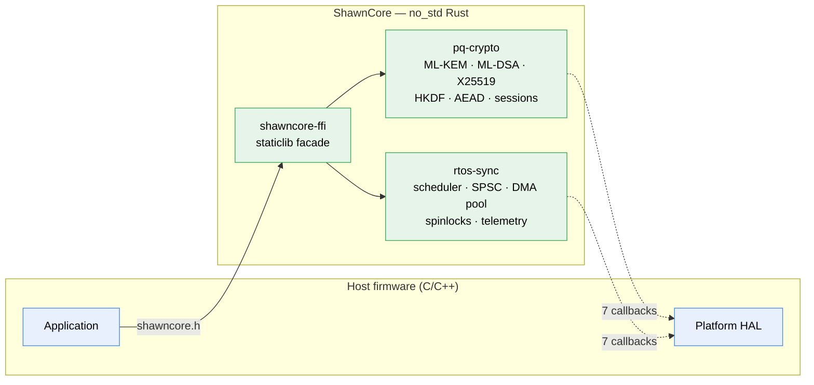

# ShawnCore Libraries

**Hybrid post-quantum session establishment and deterministic RTOS
synchronization for embedded systems, in `no_std` Rust with a C ABI.**

ShawnCore gives firmware two things that are hard to get right and dangerous to
get wrong: a hybrid ML-KEM-1024 + X25519 secure channel, and a set of lock-free
RTOS primitives with analyzable worst-case behavior. It ships as a single
self-contained static library with a C header that compiles as C99, C11 and C++11 or later.

> **Status:** release-candidate prototype for external technical evaluation.
> Not certified, not hardware-qualified, not independently reviewed.
> [VALIDATION.md](VALIDATION.md) records exactly what has been executed and what
> has not.

---

## At a glance

| | |
|---|---|
| **Key establishment** | ML-KEM-1024 + X25519, combined through HKDF-SHA384 into two independent directional keys |
| **Packet protection** | ChaCha20 + HMAC-SHA384 Encrypt-then-MAC, per-direction nonce counters, 64-entry replay window |
| **Signatures** | ML-DSA-87, optional (omitted by the `lite` configuration) |
| **RTOS primitives** | O(1) bitmap scheduler, SPSC/ring queues, ABA-tagged DMA pool, interrupt-aware spinlocks, state machine |
| **Integration** | One `staticlib`, one header for C99/C11 and C++ (135 functions, `SHAWNCORE_VERSION_*` macros), no libc, no heap, caller-allocated objects |
| **Targets built** | Host (x86-64) and `aarch64-unknown-none`. A 64-bit target with native 64-bit atomics is required; 32-bit targets such as Cortex-M are rejected at compile time |
| **Toolchain** | `no_std`, `panic = "abort"`; minimum Rust 1.88 (CI-checked), developed and validated on 1.99.1 |

---

## Why this is different

Most embedded crypto libraries quietly reach into the platform — flushing caches
with inline assembly, wiping stacks, reading RNGs, assuming coherency. Each reach
is a correctness claim the library cannot verify on a board it has never seen.

**ShawnCore makes every hardware assumption explicit and finite.** There are
exactly seven, and they are all registered host callbacks:

`panic` · `disable_interrupts` · `restore_interrupts` · `cache_flush` ·
`cache_invalidate` · `monotonic_clock` · `pet_watchdog`

That is the complete list of things a target integrator must validate. Nothing
is hidden inside the library, which is why the open validation gates in this
repository are enumerated rather than implied.

---

## Verified properties

Every claim below is reproducible from a clean checkout with
`bash validation/release_gate.sh` and the commands in [REVIEW.md](REVIEW.md).

| | |
|---|---|
| **Zero external symbols** | The `aarch64-unknown-none` archive resolves entirely within itself. `memcpy`/`memset`/`memcmp` and soft-float builtins are bundled. No libc required. Checked by [`validation/check_archive.sh`](validation/check_archive.sh). |
| **Zero heap** | No `malloc`, no `__rust_alloc`, no allocator linked. Every object is caller-allocated via published `_sizeof()`/`_alignof()`. |
| **Zero unwinding into C** | `panic = "abort"` in both profiles; the facade owns the single `no_std` panic handler. |
| **135 exported symbols** | Header declarations and archive exports are diffed in CI and must match exactly. |
| **154 Rust #[test] functions** | Crypto round trips, tampering, replay, reordering, wire round trips, FFI ownership rejection, entropy callback reentrancy, queue reuse, DMA stale generations, scheduler bounds. The Lite configuration runs its own 83-test suite. A spec-sheet conformance suite (`validation/tests/spec_sheet.rs`) checks every number in the Specifications section against the code, the header and the benchmark record. |
| **Known-answer tests for the classical primitives** | HMAC-SHA384 (RFC 4231), X25519 (RFC 7748 section 6.1), ChaCha20 (RFC 8439 keystream, cross-checked with OpenSSL), HKDF-SHA384, the hybrid KDF, and the AEAD framing, with vectors produced by independent implementations. |
| **Cross-implementation agreement with OpenSSL 3.5.8** | ML-KEM-1024 key generation from seed, deterministic encapsulation, decapsulation and implicit rejection, ML-DSA-87 key generation, deterministic signing and verification, and one complete hybrid session (transcript, key split, both packet directions) re-derived independently in Python, all byte-for-byte identical. Regenerate with [`validation/gen_openssl_vectors.sh`](validation/gen_openssl_vectors.sh). These are **not** NIST ACVP vectors. |
| **Adversarial protocol tests** | Active-attacker tests for reflection, duplication, reordering, window edges, forged tags and sequence numbers, every single-bit flip, truncation, cross-session replay, failed-handshake retry, and a demonstration that an active intermediary can relay an unauthenticated handshake. |
| **Test sensitivity** | 16 deliberate faults (accepting any tag, disabling replay detection, committing before authentication, boundary off-by-ones, dropped MAC and transcript coverage, skipped key wipes, a Lite feature leak) were applied to a disposable copy; every one made the suite fail. One gap, an unobserved key wipe, was found and closed. |
| **Clean under ASan + Valgrind** | 0 errors, 0 leaks on the C integration binary. |
| **Fuzzed** | Three harnesses (`ffi_aead_fuzz`, `session_replay_fuzz`, `rtos_stateful_fuzz`) with retained regression corpora; CI runs 10,000 executions of each. |
| **ThreadSanitizer** | Standalone SPSC and ring-buffer stress workload, no reported race. |
| **Bare-metal clean** | `cargo check --target aarch64-unknown-none` and `clippy -D warnings` for the whole workspace. |
| **Dependency advisories** | `cargo audit` reports no advisories for the root and fuzz lockfiles. |

---

## Specifications

### Cryptographic suite

| Function | Algorithm | Sizes |
|---|---|---|
| Post-quantum key establishment | ML-KEM-1024 (FIPS 203) | Public key and ciphertext 1,568 B on the wire; 32 B shared secret; 64 B keygen seed; 32 B encapsulation entropy |
| Classical key agreement | X25519 (RFC 7748) | 32 B public key, secret and shared secret; low-order and all-zero peer points rejected |
| Hybrid derivation | HKDF-SHA384 over `ML-KEM secret ‖ X25519 secret` | 128 B output, split into two independent 64 B directional keys |
| Digital signatures (optional) | ML-DSA-87 (FIPS 204) | Public key 2,592 B, signature 4,627 B on the wire; 32 B keygen seed |
| Packet protection | ChaCha20 (RFC 8439, 96-bit nonce) + HMAC-SHA384, Encrypt-then-MAC | 32 B cipher key, 32 B MAC key, 48 B tag; MAC covers `len(aad) ‖ len(ct) ‖ nonce ‖ aad ‖ ct` |
| Handshake transcript | SHA-384 over protocol label, ciphertext, sender X25519 key and caller info | 48 B, passed to HKDF as `info` |

### Session behavior

| Property | Value |
|---|---|
| Handshake entropy | 96 B for the responder (64 ML-KEM seed + 32 X25519), 64 B for the initiator (32 encapsulation + 32 X25519); uniform all-zero or all-`0xFF` input is rejected |
| Nonce | 12 B: 64-bit little-endian counter plus four zero bytes, one counter per direction |
| Sequence space | $2^{64}-1$ packets per direction; exhaustion is rejected before wraparound, and a failed encryption never consumes a nonce |
| Replay window | 64 packets; authentication precedes any window update; sequences below the window are rejected |
| Largest packet per nonce | $2^{38}-64$ bytes (ChaCha20 32-bit block-counter limit) |
| Re-establishment | Zeroizes prior keys, counters and window before installing new keys |
| Key material | No serialization entry point for secret keys; zeroized on every return path |

### Entropy

| Property | Value |
|---|---|
| Host interface | `shawncore_crypto_entropy_push`: 32 B chunks into a 64-slot lock-free SPSC queue |
| Accumulator | 48 B SHA-384 state; at most 8 queued chunks mixed per call so ISR-triggered mixing stays bounded |
| Output | Domain-separated SHA-384 (`0x00` output, `0x01` state evolution) with forward-secret state update |
| Starvation | Typed error (`ENTROPY_STARVATION`), never a silent weak key |

### RTOS primitives

| Primitive | Specification |
|---|---|
| Scheduler | 16 priority levels, 16-bit ready bitmap, O(1) selection (`trailing_zeros`), stack canary per task, watchdog petted only after every critical task checks in; 1,088 B per core |
| Task control block | 64 B, 64 B aligned |
| Queues | Lock-free SPSC queue and ring buffer, 64 B cache-line slots, sequence-validated reads, slot scrub on consume |
| DMA pool | Lock-free ABA-tagged free list (32-bit index + 32-bit generation), 63-bit per-slot generation token rejects stale frees, 4,096 B backing alignment, slot zeroized and cache-flushed on free |
| State machine | 5 states (`Init`, `Bootstrapping`, `Operational`, `Degraded`, `Terminal`), lock-free CAS, `Terminal` is absorbing |
| Interrupt-aware spinlock, latency tracker, telemetry queue | Included; all host interaction through registered callbacks |

### C interface

| Property | Value |
|---|---|
| Header | One file, [`shawncore.h`](shawncore-ffi/include/shawncore.h): C99/C11 and C++11 or later, `SHAWNCORE_VERSION_*` macros |
| Surface | 135 exported functions, 24 sized types each with `_sizeof()` / `_alignof()` (all 64 B aligned) |
| Errors | Typed status enums for crypto and RTOS; nothing is signalled out of band |
| Host callbacks | Seven: `panic`, `disable_interrupts`, `restore_interrupts`, `cache_flush`, `cache_invalidate`, `monotonic_clock`, `pet_watchdog` |
| Linking | One static archive; no libc, no allocator, no unwinding |

### Object sizes (bytes, reference build)

| Object | Size | Object | Size |
|---|---:|---|---:|
| Session manager | 4,608 | ML-DSA verifying key | 73,856 |
| ML-KEM public key | 2,112 | ML-DSA signing key | 104,640 |
| ML-KEM decapsulation key | 4,288 | ML-DSA signature | 4,672 |
| ML-KEM ciphertext | 1,600 | Scheduler | 1,088 |
| X25519 key or secret | 64 | DMA pool control object | 4,160 |

In-memory sizes are larger than the wire sizes above; the full table is in
[ARCHITECTURE.md](ARCHITECTURE.md#92-caller-allocated-opaque-objects).

### Host reference performance

Single thread, `release` profile, 1 KiB payload, 2,500 iterations per operation
in 25 batches, AMD EPYC 7763 (2 vCPU shared container), Rust 1.99.1, default
features (`fast-x25519` on). Times are the **best batch**: on a shared host it
agrees across runs to about 1%, while the median is within about 11% of it and
is listed in [BENCHMARKS.md](BENCHMARKS.md) with the exact command. These are
host numbers for comparing operations against each other, not target-hardware
performance, a constant-time claim, or certification evidence.

| Operation | Time | Ops/sec |
|---|---:|---:|
| ML-KEM-1024 keygen / encapsulate / decapsulate | 52 / 51 / 63 µs | 19,331 / 19,526 / 15,903 |
| X25519 keygen / Diffie-Hellman | 17 / 57 µs | 57,382 / 17,430 |
| ML-DSA-87 keygen / sign / verify | 410 / 229 / 102 µs | 2,440 / 4,368 / 9,821 |
| HKDF-SHA384 (128 B) / hybrid KDF (128 B) | 2.2 / 3.2 µs | 463,392 / 308,547 |
| HMAC-SHA384 (1 KiB) | 3.0 µs | 335,683 |
| AEAD encrypt / decrypt (1 KiB) | 3.5 / 3.6 µs | 283,849 / 275,028 |

A full hybrid handshake costs one ML-KEM keygen, one encapsulation, one
decapsulation, two X25519 keygens, two Diffie-Hellmans and two hybrid KDFs across
the two peers: roughly 0.32 ms of CPU on this machine.

### Build and platform

| Property | Value |
|---|---|
| Targets built and checked | x86-64 Linux host, `aarch64-unknown-none` |
| Platform requirement | 64-bit pointers and native 64-bit atomics (`AtomicU64`); both crates stop with a `compile_error!` otherwise. `thumbv7em-none-eabihf` was confirmed to fail |
| Language | `no_std` Rust, edition 2021, `panic = "abort"` |
| Toolchain | Minimum Rust 1.88, developed on 1.99.1 |
| Configurations | Full (ML-DSA and `fast-x25519` enabled), `usv` (size-optimized), `lite` (no ML-DSA, no X25519 tables); footprint figures below |
| Feature flags | `ml-dsa` (default), `fast-x25519` (default; precomputed basepoint tables for faster X25519 keygen, about 30 KB more code and rodata), `lite` |
| License | AGPLv3 or commercial; see [License](#license) |

---

## Architecture at a glance



**[Read ARCHITECTURE.md](ARCHITECTURE.md)** for the design rationale, handshake
sequence, replay-window ordering, DMA/cache boundary, and measured footprint.

---

## Quickstart

```bash
make -C integration run  # builds the release archive and runs the C integration binary
```

Link the archive and include [`shawncore-ffi/include/shawncore.h`](shawncore-ffi/include/shawncore.h).

```c
#include "shawncore.h"

/* 1. Register the platform callbacks this code path needs. */
shawncore_crypto_register_cache_flush(host_cache_flush);
shawncore_crypto_register_panic_hook(host_panic);

/* 2. Allocate the session object yourself; the library never allocates. */
static _Alignas(64) uint8_t storage[8192];
shawncore_crypto_session_manager *s = (void *)storage;
assert(shawncore_crypto_session_manager_sizeof() <= sizeof storage);
shawncore_crypto_session_manager_init(s);

/* 3. Responder: publish hybrid public keys in wire format. */
shawncore_crypto_session_manager_initiate_handshake(s, entropy96, pk, xpk);
uint8_t ek_wire[1568], x_wire[32];
shawncore_crypto_ml_kem_publickey_to_bytes(pk,  ek_wire, sizeof ek_wire);
shawncore_crypto_x25519_publickey_to_bytes(xpk, x_wire,  sizeof x_wire);
link_send(ek_wire, sizeof ek_wire);
link_send(x_wire,  sizeof x_wire);

/* 4. Initiator: rebuild the peer keys from bytes, then encapsulate against them. */
shawncore_crypto_ml_kem_publickey_from_bytes(ek_wire, sizeof ek_wire, peer_pk);
shawncore_crypto_x25519_publickey_from_bytes(x_wire,  sizeof x_wire,  peer_xpk);
shawncore_crypto_session_manager_encapsulate_for_peer(
    s2, peer_pk, peer_xpk, entropy64, NULL, 0, NULL, 0, ct, my_xpk);

/* 5. Responder: rebuild the reply from bytes and finalize. */
shawncore_crypto_ml_kem_ciphertext_from_bytes(ct_wire, 1568, ct);
shawncore_crypto_x25519_publickey_from_bytes(peer_wire, 32, peer);
shawncore_crypto_session_manager_finalize_handshake(s, peer, ct, NULL, 0, NULL, 0);

/* 6. Send. Nonces are assigned and tracked internally. */
shawncore_crypto_session_manager_encrypt_packet(
    s, aad, aad_len, pt, ct_out, len, out_nonce, out_tag);
```

Every call returns a typed status; check it. Entropy buffers must come from a
qualified host source. The fragment above elides declarations and error handling.

[`integration/c_api_smoke.c`](integration/c_api_smoke.c) runs this end to end —
two session managers completing a full hybrid handshake with every public value
passed through its wire encoding, then an authenticated packet exchange and a
replay rejection.

---

## Components

| Crate | Contents |
|---|---|
| [`shawncore-pq-crypto`](shawncore-pq-crypto) | ML-KEM-1024, ML-DSA-87, X25519, HKDF-SHA384 hybrid derivation, ChaCha20/HMAC-SHA384 Encrypt-then-MAC, entropy pool and queue, session lifecycle, replay handling, wire codecs |
| [`shawncore-rtos-sync`](shawncore-rtos-sync) | O(1) bitmap scheduler, ABA-tagged DMA pool, SPSC and ring queues, interrupt-aware spinlocks, atomic state machine, latency tracking, telemetry |
| [`shawncore-ffi`](shawncore-ffi) | C-linkable `staticlib` facade; owns the single `no_std` panic handler |

---

## Security model in one paragraph

Session decryption authenticates a packet **before** committing any replay-window
state, so forged traffic cannot poison the window or lock out a legitimate peer.
Failed encryption never advances the transmit sequence, so no failure path can
reuse a nonce. Re-establishment zeroizes prior directional keys and resets
transmit and replay state before installing replacements. Sensitive material is
explicitly zeroized on every return path, success or error. Secret keys have no
serialization entry point and cannot be exported through the ABI.

**The handshake is not authenticated.** It performs hybrid key agreement only: no
peer identity, no key confirmation, and no full-transcript binding. An active
man-in-the-middle is not defended against until an integrator adds an
authenticated layer; SECURITY.md section 10 lists the required properties.

Full trust boundaries, in-scope and out-of-scope threats, known limitations, and
the host integration contract: **[SECURITY.md](SECURITY.md)**.

---

## Key facts an integrator needs early

**The 128-byte hybrid KDF split.** For a responder, transmit material is bytes
`0..32 ‖ 96..128` and receive material is bytes `32..96`; the initiator uses the
complementary assignment. Each 64-byte directional key is 32 bytes of ChaCha20
key plus 32 bytes of HMAC-SHA384 key.

**ML-DSA-87 is RAM-expensive in this representation.** A verifying key is 73,856
bytes in memory versus 2,592 on the wire; a signing key is 104,640 bytes versus
4,896. The dependency caches expanded matrices for speed. Budget roughly 178 KB
for a signing identity, or use ML-DSA selectively.

**Page alignment is not DMA pinning, and atomics are not cache maintenance.**
The library requires 4096-byte alignment as a storage property and calls your
cache callbacks at ownership transitions. Physical residency, pinning, device
quiesce, and board-level coherency remain yours.

**The SPSC contract is a safety requirement.** One stable producer, one stable
consumer, for the entire initialized lifetime. Not enforced at runtime.

---

## Dependencies

The wrappers delegate the primitives to RustCrypto crates and add zeroization,
length/overlap validation, and the FFI boundary.

| Primitive | Crate | Version |
|---|---|---|
| ML-KEM-1024 (FIPS 203) | `ml-kem` (`hazmat` for seed-based keygen and deterministic encapsulation) | 0.3.3 |
| ML-DSA-87 (FIPS 204) | `ml-dsa` (optional) | 0.1.1 |
| X25519 | `x25519-dalek` (`precomputed-tables` through the `fast-x25519` feature) | 3.0 |
| ChaCha20 | `chacha20` | 0.10 |
| SHA-384, HMAC, HKDF | `sha2`, `hmac`, `hkdf` | 0.11, 0.13, 0.13 |
| Constant-time compare, zeroize | `subtle`, `zeroize` | 2.6, 1.9 |

The lockfiles are committed and `cargo audit` is part of CI. Constant-time
behavior is a property of these dependencies and the target compiler output; it
has not been measured here.

## Footprint

Measured on the `aarch64-unknown-none` FFI static archive with Rust 1.99.1.
"Code + rodata" is the sum over all archive members before linker garbage
collection, so it is an upper bound, not a firmware size. Measure the linked
artifact on your target.

| Profile | Archive bytes | Code + rodata bytes |
|---|---:|---:|
| `release` (full, `fast-x25519`) | 6,868,960 | 653,433 |
| `usv` (full, `fast-x25519`, `opt-level = "z"`) | 6,699,960 | 312,493 |
| `usv` without `fast-x25519` | 6,670,664 | 282,497 |
| `lite` (no ML-DSA, no X25519 tables, `opt-level = "z"`) | 6,522,042 | 251,154 |

`fast-x25519` trades about 30 KB of code and rodata for about 1.75x faster X25519
key generation (31 to 17 µs on the reference machine). It uses precomputed
basepoint tables, so Diffie-Hellman, which multiplies an arbitrary point, is
unchanged at about 57 µs. Per handshake that saves roughly 27 µs of about
350 µs. Disable it (`--no-default-features --features ml-dsa`) when flash is
tighter than handshake latency.

Static RAM in the archive is 4,489 bytes of `.bss`. Opaque object sizes are
listed in [ARCHITECTURE.md](ARCHITECTURE.md#92-caller-allocated-opaque-objects).

---

## Reproducible checks

The full gate, including ThreadSanitizer (needs a nightly toolchain), the Lite
configuration, and the archive checks:

```text
bash validation/release_gate.sh
```

The individual commands:

```text
cargo fmt --all -- --check
cargo fmt --manifest-path fuzz/Cargo.toml -- --check
cargo check --workspace --all-targets --locked
cargo test --workspace --all-targets --locked
cargo clippy --workspace --all-targets --all-features --locked -- -D warnings
cargo build --workspace --release --locked
cargo doc --workspace --no-deps --locked
cargo check --target aarch64-unknown-none --workspace --locked
cargo test -p shawncore-pq-crypto --no-default-features --features lite --locked
cargo test -p shawncore-validation --test spec_sheet --locked
cargo audit && cargo audit --file fuzz/Cargo.lock
bash validation/check_archive.sh
make -C integration syntax run cxx asan valgrind
```

`rust-toolchain.toml` pins Rust `1.99.1`, the `rustfmt` and `clippy` components,
and the `aarch64-unknown-none` target.

---

## Validation status

The evidence behind each line is in [VALIDATION.md](VALIDATION.md).

**IMPLEMENTED** — AEAD, X25519, ML-KEM-1024, ML-DSA-87, hybrid KDF and
directional session keys, wire codecs, FFI surfaces, RTOS primitives, C HAL stubs.

**TESTED** — 154 Rust #[test] functions covering crypto round trips and tampering,
known-answer vectors for the classical primitives, wire round trips proving
semantic equivalence after decode, FFI null/zero-length and overlap handling,
session re-establishment and replay paths, queue reuse and corruption paths,
DMA-pool exhaustion and stale-generation rejection, scheduler boundaries, state
transitions, the FFT one-cache-line ABI, and a spec-sheet suite that fails if the
specifications, object sizes, test counts or performance table drift from the
code. A C11 integration binary and a C++17
smoke binary compile,
links, and executes a full wire handshake against the release archive, clean
under AddressSanitizer and Valgrind.

**FUZZED** — three harnesses with retained regression corpora and a
10,000-execution CI job per harness. Compile checks are not reported as fuzz
executions, and a bounded campaign is not a security proof.

**STATICALLY REVIEWED** — strict Clippy, formatting, workspace checks,
documentation build with warnings denied, C syntax compilation, header/archive
symbol parity, archive self-containment, dependency advisory scan, and a
bare-metal AArch64 type check, all in CI.

**MODEL TESTED** — no formal model checking or exhaustive concurrency-state model
has been performed. Unit tests exercise implementation behavior only; they do not
model cache-coherent DMA hardware.

**HARDWARE VALIDATED** — not yet validated by this repository.

**NOT YET VALIDATED** — target ABI interoperability, cache coherency, DMA
visibility, ISR/NMI/FIQ behavior, watchdog behavior, entropy-source quality,
NIST ACVP known-answer tests for ML-KEM/ML-DSA, interoperability with a second
peer over a real link, free-list ABA-tag wraparound, and independent security
review.

---

## Limitations

This is a prototype for technical evaluation. It is not a claim of FIPS
certification, CNSA approval, operational USV readiness, or comprehensive
security assurance. The 32-bit DMA-pool free-list ABA tag can wrap after $2^{32}$
free-list mutations; deployments must bound that operational lifetime or
reinitialize the pool. The session handshake is unauthenticated, and no peer identity, PKI, trust-anchor, or revocation model
is defined here; that protocol layer belongs to the integrator. Retained
regression tests do not establish target timing, cache, or physical-memory
behavior.

## External review status

Independent security review, ML-KEM/ML-DSA known-answer and interoperability
testing, target ABI validation, and board-level cache/DMA, interrupt, watchdog,
entropy, and stack validation remain required before deployment or any
certification or approval conclusion.

---

## Repository map

| Document | Contents |
|---|---|
| [ARCHITECTURE.md](ARCHITECTURE.md) | Design rationale, diagrams, measured layouts, concurrency model |
| [SECURITY.md](SECURITY.md) | Trust boundaries, threat model, host integration contract |
| [REVIEW.md](REVIEW.md) | Reviewer quickstart and requested review scope |
| [VALIDATION.md](VALIDATION.md) | Host-side validation record and open external gates |
| [BENCHMARKS.md](BENCHMARKS.md) | Host benchmark methodology |
| [CHANGELOG.md](CHANGELOG.md) | Release notes |

## License

ShawnCore is dual-licensed; see [LICENSE](LICENSE) for the governing terms. The
unmodified GNU AGPLv3 text is in
[LICENSES/AGPL-3.0-or-later.txt](LICENSES/AGPL-3.0-or-later.txt).

1. **GNU Affero General Public License v3 (or later)** for open-source evaluation
   and research.
2. **Commercial license** for use in closed-source or proprietary products
   without the AGPL's copyleft obligations.

The crates are `publish = false` and are not distributed through a package
registry. For commercial licensing or integration support, contact the
copyright holder, Shawn Phillips, directly. Licensing does not alter the
validation status above: no hardware qualification, certification, or
independent review is implied by either license.

## Lite MCU Build

ShawnCore provides a constrained-MCU build configuration in addition to the
full/default configuration.

The full/default configuration keeps ML-DSA and the `fast-x25519` tables enabled.
The Lite configuration omits ML-DSA and the X25519 tables at compile/link time while retaining ML-KEM, X25519, authenticated
encryption, session management, entropy handling, and RTOS synchronization.
The C header hides the ML-DSA declarations when `SHAWNCORE_LITE` is defined.

Build the Lite crypto crate:

```text
cargo build -p shawncore-pq-crypto --no-default-features --features lite --profile lite
```

Build the Lite C facade:

```text
cargo build -p shawncore-ffi --no-default-features --features lite --profile lite
```

Lite is a constrained deployment profile, not a security-certification or
hardware-readiness claim. The `lite` feature does not itself remove anything:
always pass `--no-default-features`, or ML-DSA and the X25519 tables stay
enabled. `validation/check_archive.sh` verifies that the Lite archive contains
neither, and that its exported symbols equal the header seen with
`SHAWNCORE_LITE`. The integrating system remains responsible for
providing an appropriate device identity/authentication mechanism when ML-DSA
signatures are not available on the target.
